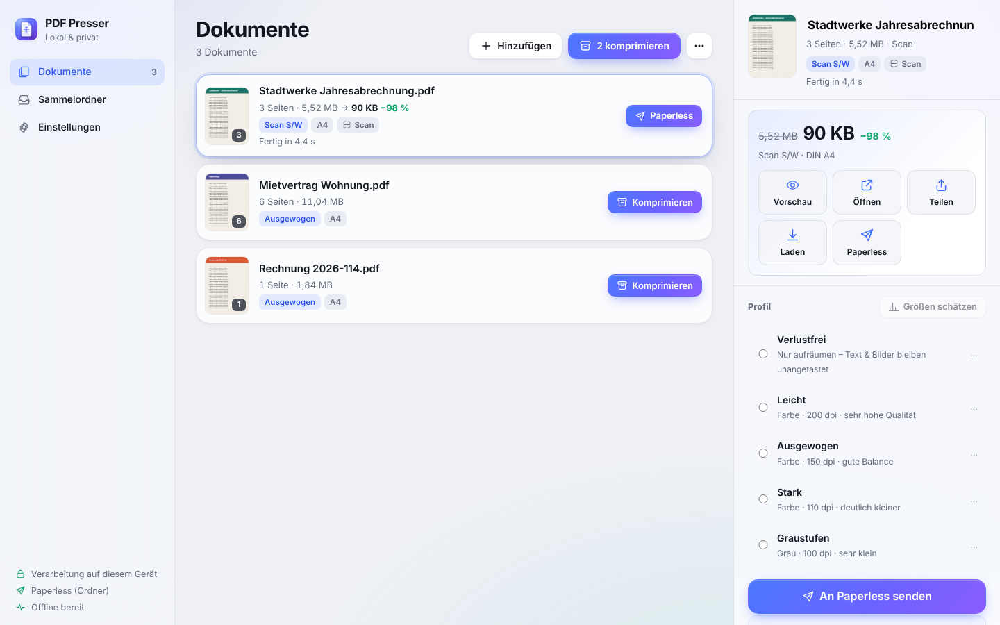

# PDF Presser

**Live (ohne Server-Funktionen):** https://kmitulla.github.io/pdfcompress/

PDFs, Fotos und Scans verkleinern, auf **DIN A4** bringen, per **Texterkennung**
durchsuchbar machen und an **Paperless** senden. Rendern, Komprimieren und OCR
laufen **im Browser** – Dateien verlassen das Gerät nur, wenn du sie selbst an
Paperless schickst.



## Was die App kann

| Bereich | Funktion |
| --- | --- |
| **Hinzufügen** | PDFs, Fotos (JPG/PNG/HEIC/WebP) oder direkt **Foto aufnehmen** (Kamera-App des Handys), Ziehen & Ablegen, Einfügen aus der Zwischenablage, **Netzwerk-Scanner** (eSCL/AirScan, z. B. Epson ET-2720) |
| **Scan-Studio** | Fotos und Scans werden automatisch zugeschnitten: Flachbett-Scans mit **festem A4-Ausschnitt ab der Anlegeecke** (in mm justierbar), Fotos mit Eckenerkennung + Perspektivkorrektur. Nachjustieren mit Lupe, Drehen, weißer Radierer, Umsortieren |
| **Stapel-Scan** | Mehrere Seiten nacheinander ohne Tippen – mit Pause zum Vorlagenwechsel, Wachhalten des Handys, Stopp-Knopf |
| **Profile** | Verlustfrei · Leicht · Ausgewogen · Stark · Graustufen · Scan Farbe (16 Farben) · Scan S/W (1-Bit, CCITT G4) – pro Dokument, mit Feinabstimmung (dpi, JPEG-Qualität, Helligkeit, Kontrast, dunkle Flächen) und Ausnahmen pro Seite |
| **Vorschau & Simulation** | „Größen schätzen“ rechnet alle Profile durch (±3 % der echten Größe), die Vorschau zeigt Original, simuliertes Ergebnis und fertiges PDF Seite für Seite |
| **DIN A4** | Jede Seite landet auf A4 (hoch/quer, nie verzerrt) – auch bei „Verlustfrei“ |
| **Texterkennung** | Tesseract (Deutsch/Englisch) legt einen unsichtbaren Textlayer an. Läuft parallel zur Seitenverarbeitung und auf zwei Kernen – rund **doppelt so schnell** wie vorher |
| **Weitergeben** | Herunterladen, **im Browser öffnen**, **Teilen** (System-Dialog), **an Paperless** (API oder consume-Ordner), Zielordner (Chrome/Edge) |
| **Bearbeiten** | Unterschreiben, Text, Stift, Stempel, Schwärzen, weiß übermalen, Bilder, Seiten verwalten, Formulare |
| **Sammelordner** | „Paperless Prepare“: Rohscans parken, sichten, als **ein** Dokument übernehmen, nach der Übergabe aufräumen |
| **Automatik** | Neue Dokumente sofort komprimieren und optional direkt an Paperless senden |

Die Oberfläche passt sich an: am Rechner Seitenleiste + Inspektor, am Handy
Tab-Leiste mit großem **+** und Blättern von unten. Hell/dunkel automatisch.

## Selbst hosten (Docker / Portainer / ZimaOS)

Mit dem mitgelieferten Server kommen Netzwerk-Scanner, Paperless, Sammelordner
und geräteübergreifende Einstellungen dazu. Das fertige Image liegt auf GitHub:
`ghcr.io/kmitulla/pdfcompress:latest` (amd64 + arm64).

```bash
docker compose up -d      # docker-compose.yml aus diesem Repository
```

**Schritt-für-Schritt (Portainer, Scanner, Paperless, Auto-Update):**
[`docs/portainer-nas-scanner-setup.md`](docs/portainer-nas-scanner-setup.md)

| Variable | Zweck |
| --- | --- |
| `SCANNER_HOST` | IP des Scanners, ggf. mit `https://` – leer = aus |
| `PAPERLESS_URL` + `PAPERLESS_TOKEN` | Upload direkt über die Paperless-API |
| `CONSUME_DIR` | consume-Ordner (Standard `/data/consume`) – auch Rückfall, wenn die API nicht erreichbar ist |
| `RAW_DIR` | Sammelordner (Standard `/data/raw`) – leer = aus |
| `DATA_DIR` | Profilspeicher (Einstellungen, Unterschriften) |
| `PORT` | Server-Port (Standard `8823`) |

### Updates

Jeder Push auf `main` baut automatisch ein neues Image (`.github/workflows/docker.yml`)
und aktualisiert GitHub Pages. Der Watchtower-Dienst in der Compose holt neue
Images alle 5 Minuten selbst ab; die App im Browser erkennt die neue Version
über den Service Worker und lädt sich neu (nie mitten in der Arbeit).

## Entwicklung

```bash
npm install
npm start          # Server mit API: http://localhost:8823
npm test           # Playwright-Tests (Rechenkern, Oberfläche, Studio, Editor, Server, PWA)
```

| Baustein | Zweck |
| --- | --- |
| [pdf.js](https://mozilla.github.io/pdf.js/) | Seiten rendern |
| [pdf-lib](https://pdf-lib.js.org/) | PDFs bauen und bearbeiten |
| `js/ccitt-g4.js` | eigener CCITT-G4-Encoder (ITU-T T.6) |
| [tesseract.js](https://tesseract.projectnaptha.com/) | OCR als WebAssembly |

Alle Bibliotheken liegen in `vendor/` – keine CDN-Abhängigkeiten, die App läuft
als installierte PWA auch offline.
